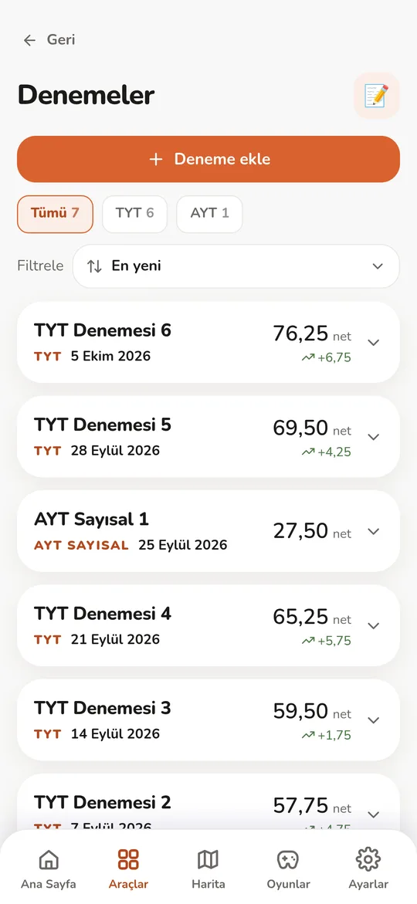
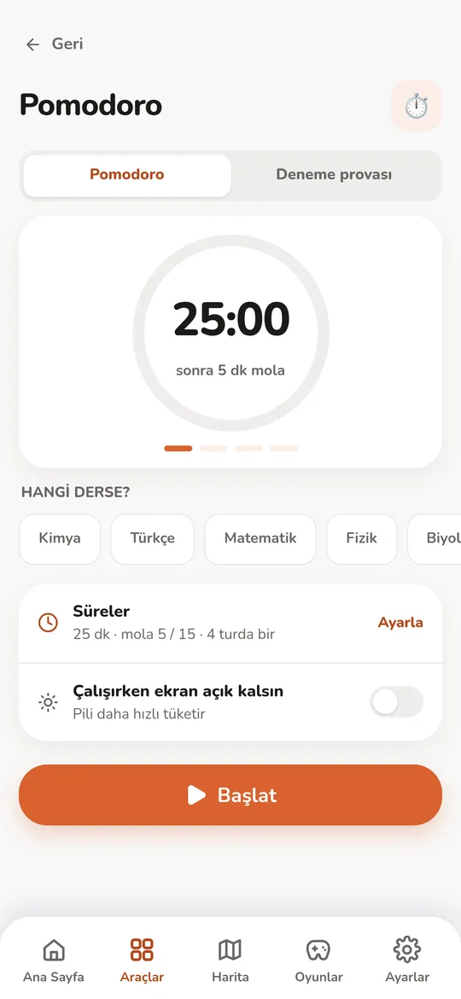
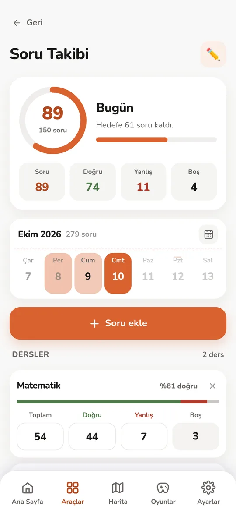
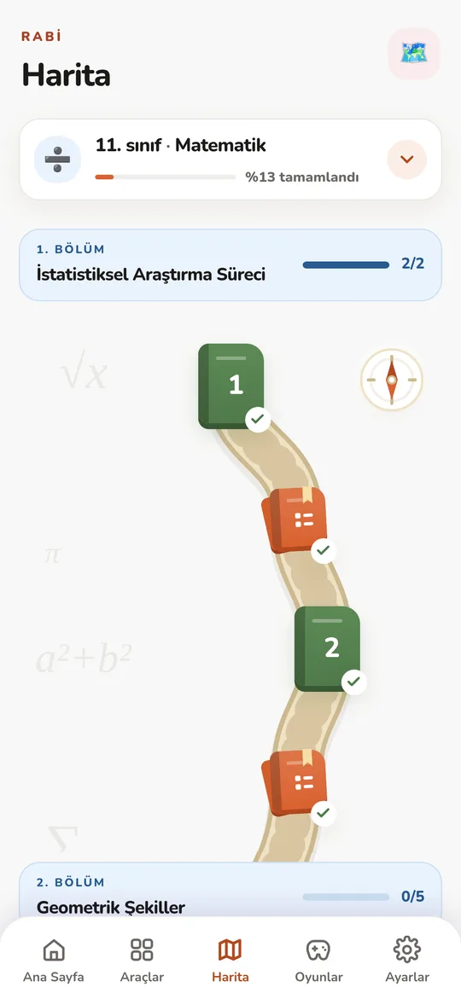
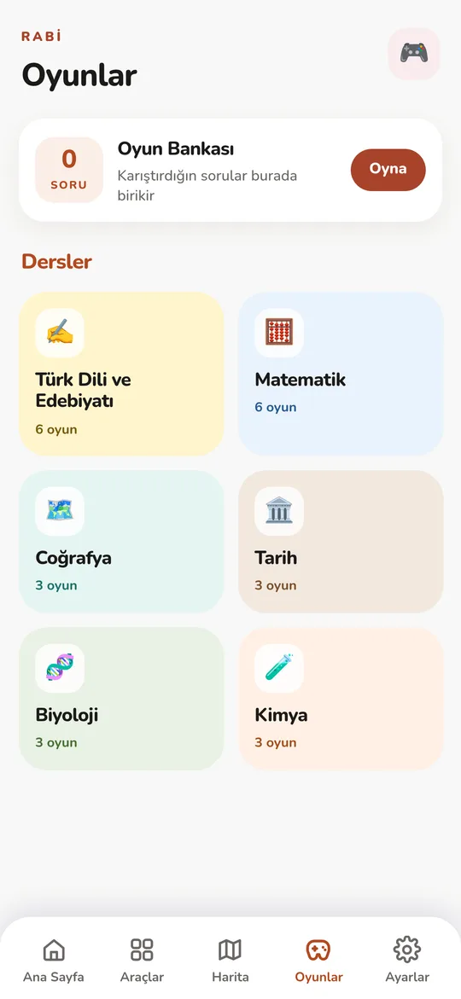
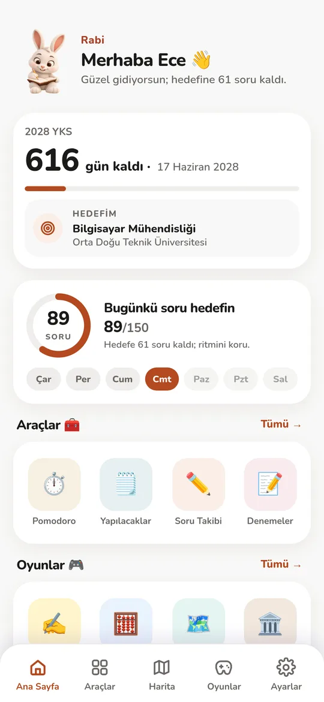

<div align="center">


# Rabi

**Lise öğrencileri için YKS çalışma asistanı.**
Hesap yok. Çalışma verilerin telefonunda kalır.

Yakında App Store ve Google Play'de.


<sub><i>An offline-first study assistant for Turkish university-entrance exam (YKS) candidates.</i></sub>

</div>

Rabi, YKS'ye hazırlanan lise öğrencisinin deneme netlerini, günlük çalışmasını ve
hedefini tek yerde toplar. Kayıt olman gerekmez; ilk açılışta sınıfını ve hedefini
seçersin, geri kalanı telefonunda çalışır. Rehberliği tavşan maskotu Rabi yapar.

## Neler var

| | |
| --- | --- |
|  | **Deneme takibi.** TYT, AYT ve YDT denemelerini gir; netlerini ve önceki denemeye göre değişimi gör, ders ders dökümüne bak. Deneme kâğıdının fotoğrafından sayıları okutabilirsin (**Okut, beta**); okuma telefonda yapılır, sonuç sen kontrol edip onaylayınca forma geçer. |
|  | **Pomodoro.** Ders seçip süre ve mola ayarlayabilir, **Deneme provası** sekmesiyle gerçek sınav süresine göre (TYT 165 · AYT 180 · YDT 120 dk) çalışabilirsin. Kilit ekranında sayaç ve Android'de odak kilidi var. |
|  | **Soru takibi ve yanlış soru bankası.** Günlük çözdüğün soruyu ders ders doğru, yanlış, boş olarak kaydet; hedefine ne kadar kaldığını gör. Yanlış sorularının fotoğrafını çekip üstüne çizebilirsin. |
|  | **Konu haritası.** Maarif müfredatına göre sınıf ve derse ayrılmış yol; her bölümde bilgi kartları ve ardından doğru/yanlış yoklaması. |
|  | **Mini oyunlar.** Türk Dili ve Edebiyatı, Matematik, Coğrafya, Tarih, Biyoloji ve Kimya gibi derslere göre mini oyunlar. Oyunda yanlış bildiğin sorular **Oyun Bankası**'nda biriktirilir, oradan tekrar edersin. |
|  | **Ana sayfa.** YKS'ye kalan gün, hedef bölümün ve bugünkü soru hedefin tek bakışta. |

Bunların yanında:

- **Sıralama tahmini.** Netlerinden puan, puandan tahmini başarı sırası; hedef bölümün
  ÖSYM kılavuzundaki başarı sırasıyla karşılaştırma. Yöntem aşağıda ([bak](#sıralama-tahmini-nasıl-hesaplanıyor)).
- **Konu takibi.** Konuları aşama aşama işaretle: haritada çalıştım, okulda öğrendim,
  soru çözdüm, bitirdim. Ekran sınıfa (9, 10, 11, 12) göre ayrılır.
- **Yapılacaklar**, MEB yönetmeliğine göre **devamsızlık** hakkı takibi, **başarımlar**
  ve **aylık özet**.

> Puan ve sıralama sonuçları **tahmindir**; uygulama bunları her zaman böyle sunar.

## Nasıl çalışıyor

Uygulama bir web uygulaması olarak yazılıp telefona Capacitor ile paketlenir.

| Katman | Kullanılan |
| --- | --- |
| Arayüz | Next.js 16 (statik export), React 19, TypeScript, Tailwind CSS v4 |
| Telefona paketleme | Capacitor 8 (Android ve iOS) |
| Veri | Cihazda: küçük veriler `localStorage`, fotoğraflar IndexedDB. Hesap yok. |
| Deneme okutma | Telefonda çalışan OCR (onnxruntime-web, Web Worker); modeller uygulamanın içinde |
| Test | Vitest |

Kodun tamamı Türkçe yazılmıştır (değişken, dosya ve yorum adları dahil).

### Klasör yapısı

```text
app/          Next.js giriş noktası (sayfa, düzen, genel stiller)
components/   Arayüz bileşenleri; components/ekranlar/ altında uygulamanın ekranları
lib/          React'e bağlı olmayan saf mantık (puan, sıralama, hesaplar) ve testleri
lib/veri/     ÖSYM verileri ve hedef bölüm kataloğu (JSON)
lib/oyunlar/  Mini oyunların mantığı ve soru havuzları
lib/konu/     Konu kartları, harita ve müfredat içeriği
android/      Android projesi (Capacitor)
ios/          iOS projesi (Capacitor)
public/       Statik dosyalar (maskot görselleri, gizlilik sayfaları)
docs/         Alan alan proje kuralları (docs/kurallar/) ve ekran görüntüleri
scripts/      Derleme yardımcı betikleri
tasarim/      Tasarım taslakları (HTML); derlemeye girmez
```

### Sıralama tahmini nasıl hesaplanıyor

Hesap, ÖSYM'nin kendi yayımladığı yönteme dayanır (kaynak: 2026 YKS Kılavuzu,
madde 3.10.1; kod: [`lib/puan.ts`](lib/puan.ts) ve [`lib/siralama.ts`](lib/siralama.ts)):

1. **Ham puan** = doğru − yanlış / 4.
2. **Standart puan** = 50 + 10 × (ham puan − ortalama) / standart sapma. Ortalama ve
   standart sapma, ÖSYM'nin yayımladığı sınav istatistiklerinden alınır.
3. **Ağırlıklı puan:** testlerin standart puanları, kılavuzdaki ağırlıklarla (TYT, SAY,
   EA, SÖZ, DİL) toplanır.
4. Ağırlıklı puan 100–500 aralığına doğrusal olarak ölçeklenir. ÖSYM ölçeğin uçlarını
   yayımlamadığı için bu adım bir **varsayımdır**: üst uç tam net yapan adayın puanı,
   alt uç ise yayımlanmış puan dağılımının ortalamasına oturtularak çözülür.
5. **Yerleştirme puanı** = sınav puanı + OBP × 0,12.
6. **Sıralama:** ÖSYM'nin her yıl yayımladığı "Yerleştirme Puanlarının Yığınsal
   Dağılımı" tablosu, her puan eşiğinin üstündeki aday sayısını verir; yani doğrudan bir
   sıralama tablosudur. Eşik arası değerler logaritmik iç değerle bulunur. Uygulama 2024,
   2025 ve 2026 verilerini kullanır ve tek bir sayı yerine bu yılların oluşturduğu bir
   **aralık** gösterir.

Hedef bölümlerin başarı sıraları da ÖSYM kılavuzundan alınmış kataloğa dayanır
(`lib/veri/hedef-katalog-2025.json`). Sınavın zorluğu yıldan yıla değiştiği için
sonuçlar kesin değildir.

## Geliştirme

```bash
npm install
npm run dev        # http://localhost:3000 (tarayıcıda mobil görünümde aç)
npm run typecheck
npm run test
```

Android derlemesi için Android SDK ve **JDK 21** gerekir. Kurulumun tamamı, Android
derlemesi ve katkı kuralları [CONTRIBUTING.md](CONTRIBUTING.md) içindedir. Proje
kuralları ve tasarım kararları [`AGENTS.md`](AGENTS.md) dosyasındadır.

## Gizlilik

Çalışma verilerin telefonunda kalır. Ağa yalnızca şu durumlarda çıkılır: senin
gönderdiğin hata veya öneri bildirimi, her seferinde onayını isteyen çökme raporu ve
Play Store güncelleme denetimi. Ayrıntılar: [gizlilik politikası](https://ycistak.github.io/Rabi/).

## Katkı, güvenlik, sürümler

- Katkı vermek istersen önce [CONTRIBUTING.md](CONTRIBUTING.md) dosyasına bak.
  Müfredat veya soru içeriğinde yanlış ya da eksik bir şey görürsen "İçerik düzeltmesi"
  başlıklı issue şablonunu kullan.
- Güvenlik açığı bildirimi: [SECURITY.md](SECURITY.md).
- Davranış kuralları: [CODE_OF_CONDUCT.md](CODE_OF_CONDUCT.md).
- Sürüm notları: [CHANGELOG.md](CHANGELOG.md).

## Lisans

Kaynak kod [MIT](LICENSE) lisansıyla paylaşılır.

**"Rabi" adı, logosu ve tavşan maskotu lisans kapsamı dışındadır**; Fluxify Interactive'e
aittir ve izinsiz kullanılamaz.

---

Geliştirici: **Fluxify Interactive** ([@YCistak](https://github.com/YCistak)) ·
İletişim: fluxifyinteractive@gmail.com
